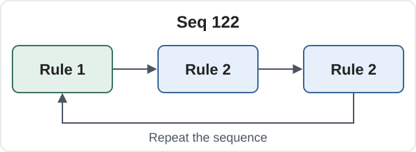

# Oblique spaceships in rule-sequence cellular automata

These cellular automata run on a two-dimensional square grid, where each cell interacts with its eight surrounding neighbors. Rules are numbered 1, 2, ..., and a repeating **rule sequence** specifies which rule updates the entire grid at each generation. All cells update simultaneously using the selected rule.

For example, **`Seq 122`** applies Rule 1, then Rule 2 twice, and repeats. Cells can have two or more states, and different rules can use different state counts.



Each box represents one generation; the selected rule updates all cells. **`Seq 1`** repeats a single rule; **`Seq 12`** alternates two rules; **`Seq 122`** repeats a three-generation sequence.

This repository collects **oblique spaceships** found in these systems: patterns that repeat while shifting in a direction that is neither horizontal, vertical nor diagonal. Each entry provides its rules, sequence, initial pattern and a runnable browser demo.

This repository records oblique spaceships discovered by [Kazuhiro Tanimoto](https://kazuhirotanimoto.com/) while studying [rule-switching cellular automata](https://kazuhirotanimoto.com/research/rule_switching_ca/). The snapshot dated October 12, 2026 contains **4,798 entries**, with complete rules, temporal sequences and initial structures.

The list includes many spaceships that require specific initial structures, including examples that are extremely unlikely to emerge from random initial configurations. Many entries are related variants, and the collection has not yet been fully organized. An entry is a recorded rule-sequence-pattern combination; the entry count is not a count of distinct velocities or unrelated spaceship families.

## Browse and run a demo

**[Open the spaceship list and browser demos](https://kazuhirotanimoto.github.io/oblique-spaceships-in-rule-sequence-ca/).**

Download the repository and open [index.html](index.html) in a browser. Click a rule set to open its demo. The pages also work on a static web server without a build step or external dependencies.

The list can be sorted by entry number, exact slope and report date. Entry numbers stay attached to their records when sorting. Each demo starts with the listed structure centered on a toroidal board. Use **Start / Stop**, **Step**, **Reset**, the editable rule and sequence fields, and the state color selector. Reset restores the recorded initial structure. The trajectory follows the circular centroid, sampled once per listed period. Leaving the browser tab pauses playback and returning resumes it if it was running.

The displayed `(dx,dy)c/p` means a translation by `(dx,dy)` after `p` generations, with positive x to the right and positive y upwards. The demo reflects the stored structure when needed to show upper-right motion; its displayed displacements are absolute values, while signed source displacements remain in the link metadata. The displacement and period are recorded without reducing the velocity fraction. The maximum population counts every nonzero state, including refractory states. Report dates are dates assigned in the study, rather than claims of priority over all previous publications.

Single-rule cellular automata are also supported: define one rule and use `Seq 1` to apply it every generation. This works with both an explicit initial pattern and random initialization, for example `B3/S23/C2; Seq 1; Init Random 20%` (Conway's Game of Life).

## Notation and normalization

- [Rule Sequence CA notation](rule_sequence_ca_notation.md) defines `B/S/C`, `Seq`, `Init` and state transitions, and includes the complete normalization explanation.
- Start with [normalization steps and examples](rule_sequence_ca_notation.md#5-canonicalization-of-rules-and-sequences), then see [the phase-wise C calculation](rule_sequence_ca_notation.md#115-general-canonical-state-count-definition), [the scope of equivalence](rule_sequence_ca_notation.md#116-independence-from-the-initial-configuration) and [Python usage](rule_sequence_ca_notation.md#16-python-usage).
- [rule_sequence_canonical.py](rule_sequence_canonical.py) is the reference publication normalizer. It uses the Python standard library.
- [oblique_list.txt](oblique_list.txt) contains one complete `Rules; Seq; Init` expression per line, in the original table order. It is UTF-8 text.

The browser demos replay the supplied expressions. They support explicit `Init` patterns with `0` for empty cells, bracketed numeric symbols, and both `Init Random 20%` and `Init Random(0.2)`. Random forms initialize only states 0 and 1 at the specified density, including 0% and 100%; Reset generates a fresh board at the same density while retaining edited rules, sequence and palette. Try the equivalent [20% random demo](oblique_demo.html?ca=B3%2FS23%2FC2%3B%20Seq%201%3B%20Init%20Random%2020%25) and [density-0.2 random demo](oblique_demo.html?ca=B3%2FS23%2FC2%3B%20Seq%201%3B%20Init%20Random%280.2%29).

Each explicit cell is written separately; dot notation and repetition shorthand are not supported.

The demos do not perform publication normalization. The normalizer operates on `Rules + Seq`; it does not minimize a particular pattern or modify `Init`.

## Files

```text
README.md
CITATION.cff
LICENSE
LICENSES/
    CC0-1.0.txt
    CC-BY-4.0.txt
rule_sequence_ca_notation.md
rule_sequence_canonical.py
oblique_list.txt
index.html
oblique_demo.html
assets/
    style.css
    rule-sequence.svg
    oblique_list.js
    oblique_demo.js
    rule_switching_ca_core.js
    single_rule_oblique_spaceship_trail.js
tests/
    archive.test.cjs
    test_normalization.py
```

The HTML list stores each demo's complete expression and its displacement, period, maximum nonzero population and board size in the demo link. No external research catalog is loaded at runtime. The simulation scripts are snapshots of the study's implementation. The main study website can be read at [Rule-Switching Cellular Automata](https://kazuhirotanimoto.com/research/rule_switching_ca/).

## Author, citation and dates

The study and spaceship collection are by **[Kazuhiro Tanimoto](https://kazuhirotanimoto.com/)**.

When citing the study or collection, include the author, archive title, the snapshot date or release version you used, and the repository URL. Prefer a link to that exact release or commit so readers can retrieve the same records. For an individual entry, also include its entry number within that snapshot and its complete CA expression.

Suggested citation for the initial archive release (see [CITATION.cff](CITATION.cff) for machine-readable metadata):

```text
Kazuhiro Tanimoto. Oblique spaceships in rule-sequence cellular automata.
Version 1.0.0, snapshot 2026-10-12.
https://github.com/KazuhiroTanimoto/oblique-spaceships-in-rule-sequence-ca/releases/tag/v1.0.0
```

Each entry's **Report date** is the date assigned to that record in the study. It is not automatically the original discovery date or the first public disclosure date, and does not claim priority over all earlier reports. The archive snapshot date identifies the collection's recorded state; the GitHub release date identifies when that version was published. Keep these dates distinct, and reference the source of a prior report if one is identified.

## License

- **Implementation code: [CC0 1.0 Universal](LICENSES/CC0-1.0.txt)**, including JavaScript, Python, CSS, test code, HTML markup and executable code examples.
- **Explanatory text, diagrams and study data: [CC BY 4.0](LICENSES/CC-BY-4.0.txt)**, including this README, the notation document's prose, HTML explanations, the rule-sequence diagram, the TXT list and recorded table data. CA notation expressions are study data.

HTML contains both categories. See [LICENSE](LICENSE) for the precise scope. Kazuhiro Tanimoto applies these terms to the extent that he holds the relevant rights; rights-free facts and separately identified third-party material are not restricted by this declaration.

When sharing material covered by CC BY 4.0, give appropriate credit to Kazuhiro Tanimoto, retain supplied notices, link to the source and license, and indicate changes as required by the license. The citation guidance above is a convenient academic format, not an additional license condition. Code covered by CC0 does not require attribution. The material is provided without warranties under the applicable legal text.

## Automated verification

From this directory, with Node.js and Python installed:

```sh
node --test tests/archive.test.cjs
python -m unittest discover -s tests -p "test_*.py"
```

The checks cover local page and asset links, every published expression and its URL, normalization and idempotence, and representative full-state spaceship recurrences using the archived simulator. These tests do not open a browser or require the external research catalogs.

Explanatory text and study data: Copyright (c) 2026 Kazuhiro Tanimoto, CC BY 4.0. Implementation code: CC0 1.0 Universal.
